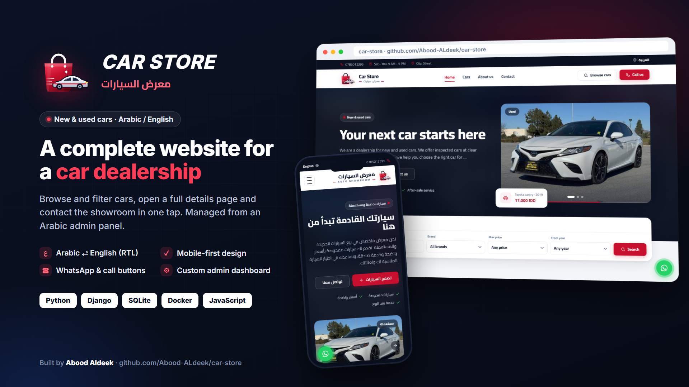
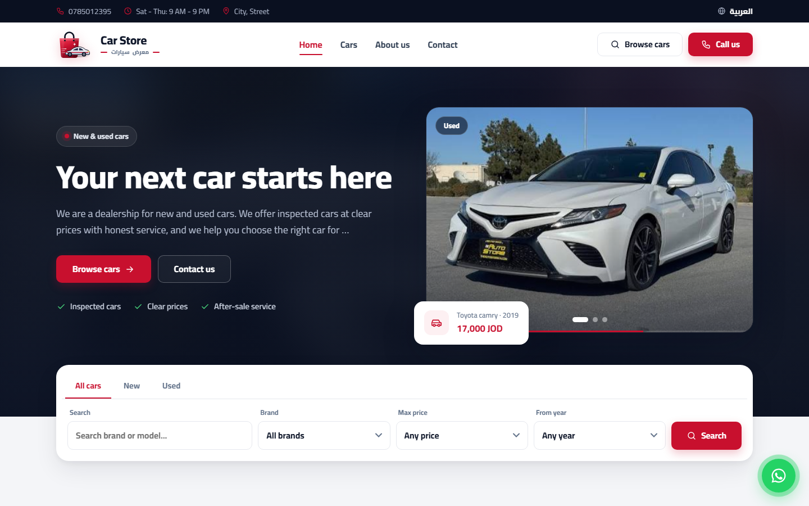
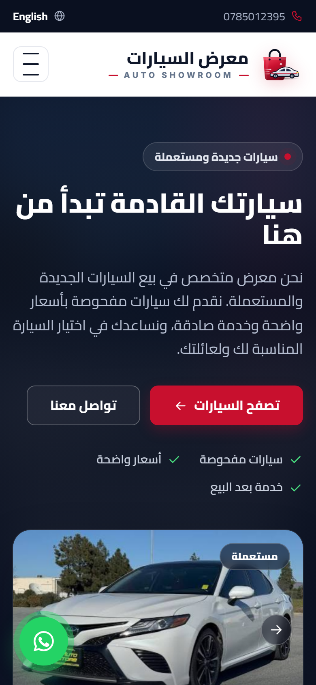
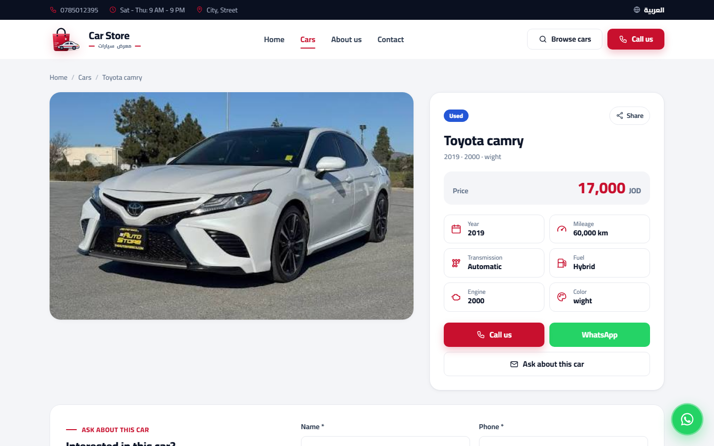
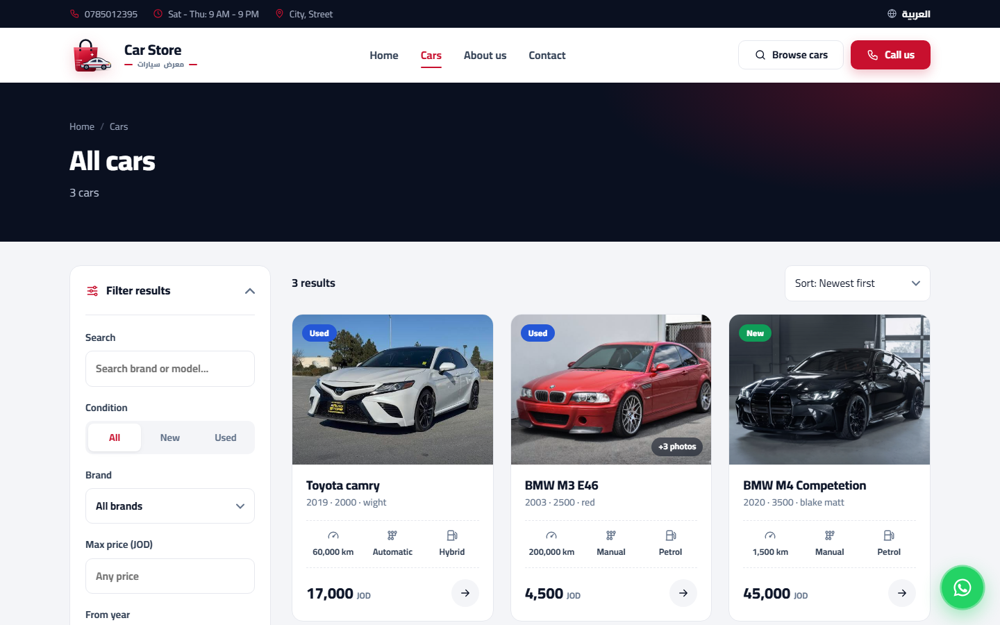
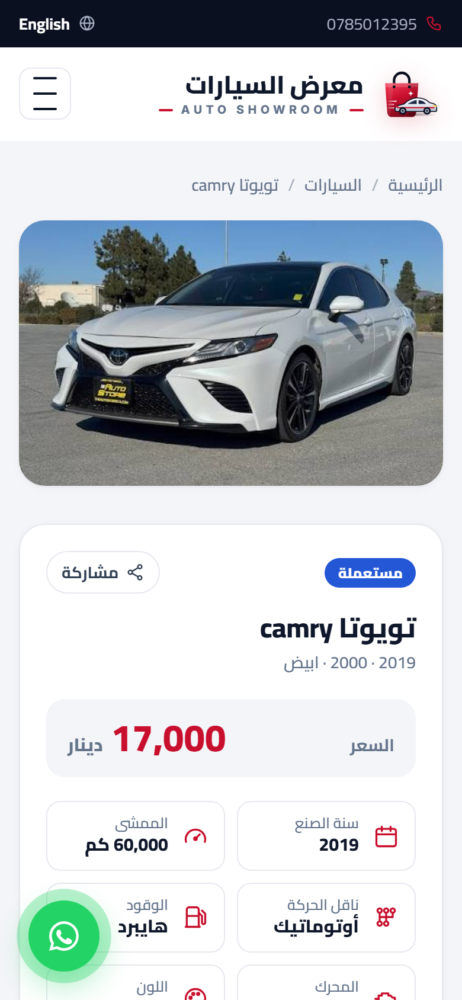
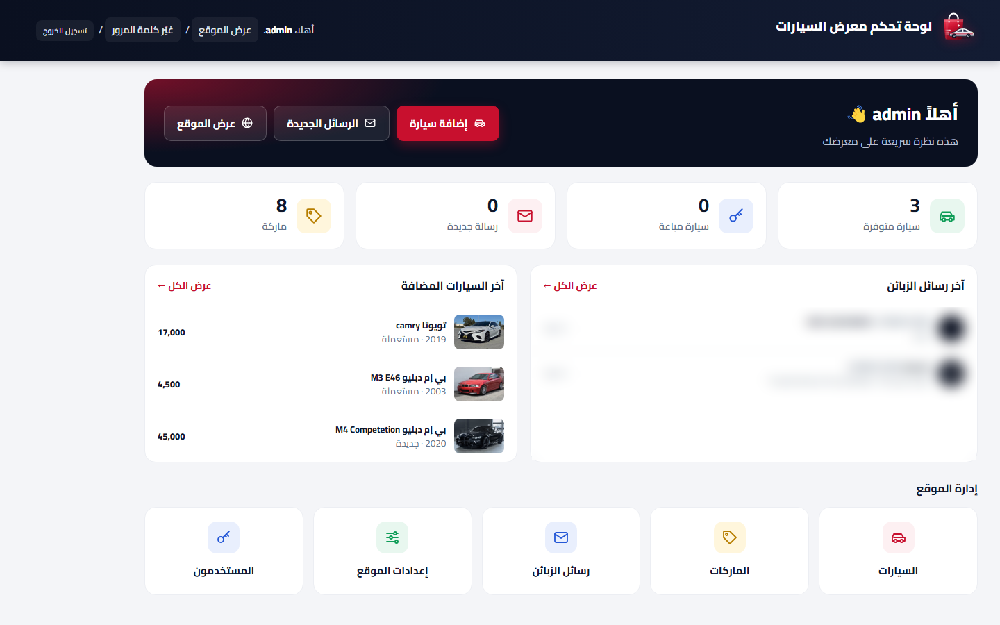
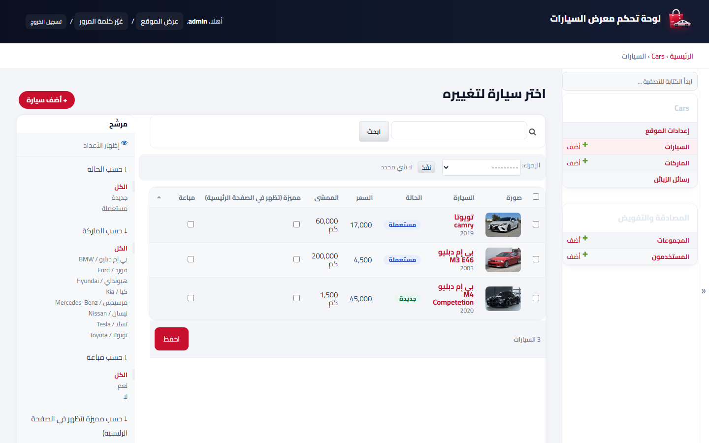

<p align="center">
  
</p>

<h1 align="center">Car Store · Car Dealership Website</h1>

<p align="center">
  A bilingual (Arabic / English) website for a car dealership that sells <b>new and used cars</b>.<br>
  Visitors browse and filter cars, open a full details page and contact the showroom by <b>phone, WhatsApp or a form</b>.<br>
  The owner manages cars, photos, messages and all site texts from an Arabic admin panel, no coding needed.
</p>

<p align="center">
  
  
  
  
  
  
</p>

<p align="center">
  <a href="https://www.linkedin.com/feed/update/urn:li:activity:7529216804431421440/">
    
  </a>
</p>

<p align="center">
  
</p>

---

## Screenshots

| Home (desktop) | Arabic · mobile |
|---|---|
|  |  |

| Car details | All cars with filters | Car page · Arabic mobile |
|---|---|---|
|  |  |  |

| Admin dashboard | Admin · cars |
|---|---|
|  |  |

## Features

**For visitors**
- Arabic ⇄ English switch with a full right-to-left layout for Arabic
- Home page with a photo **slideshow** of featured cars (fade + slow zoom, swipe on phones), live price card and animated counters
- Search by brand or model, filters for new / used, brand, max price and year, plus sorting and paging
- Car page: photo gallery, price, specs with icons (year, mileage, gearbox, fuel, engine, color), share button
- Contact the showroom in one tap: **call**, **WhatsApp** (message pre-filled with the car and its link) or an inquiry form
- About and contact pages, map, opening hours, floating WhatsApp button
- Smooth animations: page loading bar, scroll reveal, hover effects; works on any screen size
- Custom logo: a car driving out of a shopping bag

**For the dealership owner (admin panel, in Arabic)**
- Dashboard with stats (cars available, sold, new messages, brands), latest messages and latest cars
- Add / edit cars with a main photo and extra photos, mark them featured, sold or hidden
- Customer messages inbox: opening a message marks it read, one-click **reply on WhatsApp** or call
- Site settings: store name, logo, slogan, phone, WhatsApp, address, hours, map, currency, "About us" text in both languages

**Security & reliability**
- CSRF protection on every form, honeypot field against spam bots
- Secrets and settings from environment variables, secure cookies behind HTTPS
- Safe redirects on the language switch, custom 404 page
- Docker health check and automatic restart

## Tech stack

| Layer | Tools |
|---|---|
| Backend | Python 3.12, Django 5.2, Gunicorn |
| Database | SQLite |
| Frontend | Django templates, plain CSS (RTL/LTR), vanilla JavaScript, inline SVG icons |
| Images & static files | Pillow, WhiteNoise |
| Deployment | Docker / Docker Compose on a Linux server, Cloudflare Tunnel |

## Run it yourself

**With Docker**
```bash
git clone https://github.com/Abood-ALdeek/car-store.git
cd car-store
cp .env.example .env      # then set DJANGO_SECRET_KEY and DJANGO_ALLOWED_HOSTS
docker compose up -d --build
docker compose exec carstore python manage.py createsuperuser
```
Then open `http://localhost:8095` (admin panel at `/admin/`).

**Without Docker**
```bash
python -m venv .venv
.venv/Scripts/activate        # Windows  (Linux/macOS: source .venv/bin/activate)
pip install -r requirements.txt
python manage.py migrate
python manage.py create_admin  # creates the "admin" user, password saved in ADMIN-LOGIN.txt
python manage.py seed_demo     # optional: adds demo cars with generated pictures
python manage.py runserver
```

On Windows, `launcher.pyw` runs the site hidden in the background with a guard that restarts it if it stops (`run.bat`, `run.bat admin`, `run.bat stop`).

## Project structure

```
cars/            the app: models, views, admin, forms, translations, template tags
  templates/     public pages (home, cars, car page, about, contact)
templates/admin/ custom admin theme and dashboard
static/          CSS, JavaScript, logo
config/          Django settings and URLs
```

---

<p align="center">Built by <b>Abood Aldeek</b></p>
